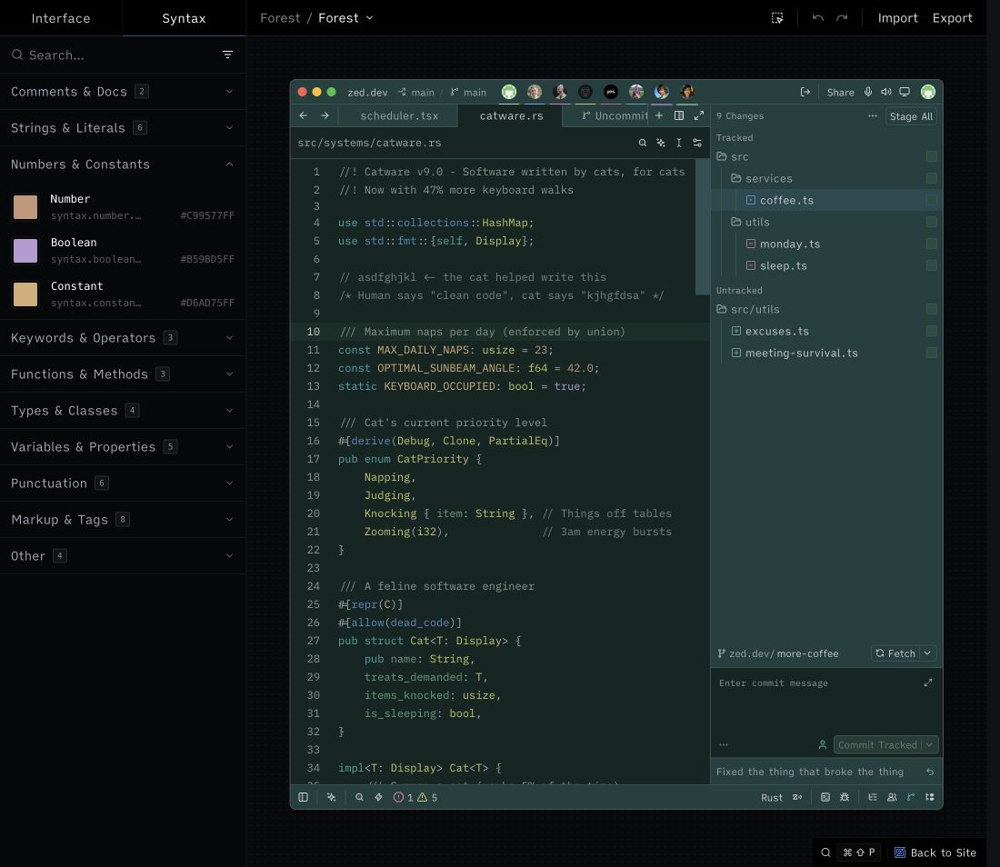

# Forest

[简体中文](README.zh-CN.md)

A deep forest green theme for [Zed](https://zed.dev), with teal keywords, yellow-green types, and separate colors for constants, numbers, and booleans. The extension provides one dark theme named **Forest**.

**Status:** version 0.1.1, available as a development extension. [Registry PR #7928](https://github.com/zed-industries/extensions/pull/7928) has been submitted and is awaiting review; Forest is not yet published in the official Zed extension registry. See the [changelog](CHANGELOG.md) for the contrast improvements.



This screenshot shows version 0.1.0 in the web Theme Builder; it does not include the 0.1.1 contrast improvements. The web preview does not reproduce every desktop syntax capture, font weight, or language-server semantic token.

On 2026-10-09, the owner manually installed and selected Forest 0.1.1 in Zed 1.23.2 on macOS. Subsequent computer-assisted UI inspection checked JSON and a standalone TypeScript example, including type, constant, number, and boolean colors, search matches, selections, and terminal ANSI red, green, yellow, blue, magenta, and cyan. The optional Rust semantic settings and uninstallation were not tested. The exact tested commit is recorded in [PUBLISHING.md](PUBLISHING.md).

## Install

Clone this repository and keep the checkout on your machine:

```sh
git clone https://github.com/lazyanubis/zed-forest.git
```

In Zed, open **Extensions**, choose **Install Dev Extension**, and select the `zed-forest` directory containing `extension.toml`. Then run **theme selector: toggle** from the command palette and select **Forest**. This follows Zed's [development extension workflow](https://zed.dev/docs/extensions/developing-extensions).

This is a theme-only extension; it contains no Rust code or WebAssembly module.

## Uninstall

Select another theme first. Open **Extensions**, find **Forest**, and choose **Uninstall**. Any settings you manually added from the optional example remain yours to remove or restore.

## Palette

| Element | Color |
| --- | --- |
| Editor background | `#132623` |
| Panels | `#20403f` |
| Keywords | `#2ea9aa` |
| Types, bold | `#c6c666` |
| Constants | `#d6ad75` |
| Numbers | `#c99577` |
| Booleans | `#b59bd5` |
| Variables | `#639dd0` |
| Parameters | `#a093bd` |
| Properties | `#6baa85` |
| Function definitions | `#d07bd2` |
| Macros | `#4eade5` |

The theme also defines terminal colors, diagnostics, selections, search matches, and collaboration colors. The language grammar and semantic tokens determine which syntax color an identifier receives.

## Optional semantic highlighting

The extension works without [settings.example.json](settings.example.json). That file is an optional, manually merged settings example for richer Rust highlighting and inlay hints; it is not installed or applied by the extension.

Review the example and merge only the fields you want into your existing Zed settings. Do not replace your whole settings file or overwrite existing semantic rules blindly.

- Rust uses combined syntax and semantic highlighting, with inlay hints enabled.
- Global semantic rules map declarations, mutable variables, and macro tokens to theme styles. These rules can also affect other languages where semantic highlighting is enabled.
- The global inlay-hint background setting can affect hints in other languages too.

Support depends on your Zed version and language server. The example does not guarantee identical coloring across languages. See Zed's [semantic token documentation](https://zed.dev/docs/semantic-tokens).

## Publishing and license

See [PUBLISHING.md](PUBLISHING.md) for the submitted registry PR, desktop verification scope, and publishing workflow.

[MIT](LICENSE) © 2026 Anubis.
