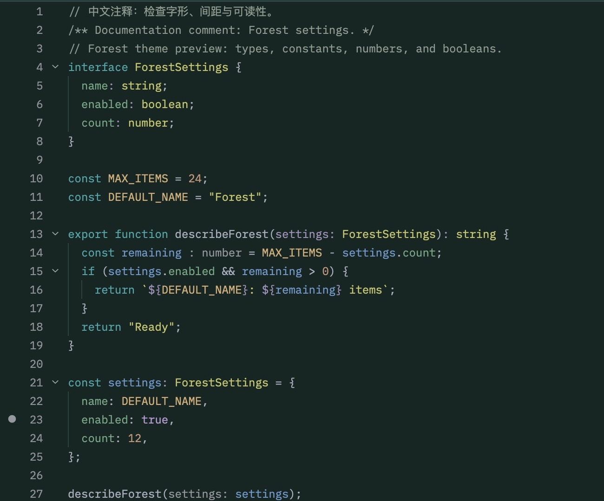

# Forest

[English](README.md)

适用于 [Zed](https://zed.dev) 的墨绿色主题。关键字采用青色，类型采用黄绿色，常量、数字和布尔值分别使用不同颜色。扩展提供一个名为 **Forest** 的深色主题。

**当前状态：** 0.1.3，可通过开发扩展方式安装。[官方目录 PR #7928](https://github.com/zed-industries/extensions/pull/7928) 正在等待审核，尚未上架 Zed 官方扩展目录。选区、字体样式和对比度调整见[更新记录](CHANGELOG.md)。



这是 macOS 的 Zed 1.23.2 中 Forest 0.1.2 的代码区域截图，使用 Lilex、12 px、400 字重、约 20 px 行高。代码来自[此 TypeScript 示例](examples/forest.ts)，没有本地 Forest 主题覆盖。[原始网页预览](preview.jpg) 保留供对照。

2026-10-09，仓库所有者在 macOS 的 Zed 1.23.2 中手动安装并选择了 Forest 0.1.1。随后通过计算机辅助界面操作检查了 JSON 和独立 TypeScript 示例，包括类型、常量、数字和布尔配色、搜索命中、选区，以及终端 ANSI 红、绿、黄、蓝、紫、青。Rust 可选语义设置和卸载流程尚未测试。随后在同一应用中安装并检查了 0.1.2：普通注释和文档注释为正体，类型不再强制加粗。验证记录见 [PUBLISHING.md](PUBLISHING.md)。

## 安装

克隆仓库，并保留本地目录：

```sh
git clone https://github.com/lazyanubis/zed-forest.git
```

在 Zed 中打开 **Extensions**，点击 **Install Dev Extension**，选择包含 `extension.toml` 的 `zed-forest` 目录。随后在命令面板运行 **theme selector: toggle**，选择 **Forest**。详见官方[开发扩展说明](https://zed.dev/docs/extensions/developing-extensions)。

这是纯主题扩展，无需添加 Rust 代码或 WebAssembly 模块。

## 卸载

先切换到其他主题，再打开 **Extensions**，找到 **Forest** 并选择 **Uninstall**。如果手动合并过可选设置，卸载扩展不会撤回这些设置，需要自行删除或恢复。

## 主要配色

| 内容 | 颜色 |
| --- | --- |
| 编辑区背景 | `#132623` |
| 面板 | `#20403f` |
| 关键字 | `#2ea9aa` |
| 类型 | `#c6c666` |
| 常量 | `#d6ad75` |
| 数字 | `#c99577` |
| 布尔值 | `#b59bd5` |
| 变量 | `#639dd0` |
| 参数 | `#a093bd` |
| 字段 | `#6baa85` |
| 函数定义 | `#d07bd2` |
| 宏 | `#4eade5` |

主题还包含终端、诊断、选区、搜索匹配及协作配色。标识符最终采用哪种颜色，取决于语言语法和语义高亮如何识别它。

## 字体与字重

Forest 不打包或安装字体，也不会修改编辑器字体设置。[Theme Builder](https://zed.dev/theme-builder) 的样式声明为 Lilex Regular（400）、0.75rem 字号、1.25rem 行高，在默认根字号 16 px 时对应 12 px 和 20 px。若想在 Zed 中使用这组设置，请先确保本机可用 Lilex，再将以下可选字段合并到现有设置：

```json
{
  "buffer_font_family": "Lilex",
  "buffer_font_size": 12,
  "buffer_font_weight": 400,
  "buffer_line_height": { "custom": 1.666667 }
}
```

可以按屏幕和阅读习惯调整字号。即使参数一致，浏览器和桌面应用的字体渲染也不保证逐像素相同。

从 0.1.2 起，代码语法使用编辑器设置的字重，普通注释和文档注释默认采用正体，不需要本地主题覆盖。Markdown 标题和加粗强调仍保留粗体，其余原有的非注释斜体样式保持不变。参考 Zed 的[字体设置](https://zed.dev/docs/appearance)和[主题定制](https://zed.dev/docs/themes)。

## 可选语义高亮

无需添加任何设置即可使用主题。[settings.example.json](settings.example.json) 包含上述可选字体设置，以及用于增强 Rust 语义高亮和类型提示的配置；扩展不会自动安装或应用它。

先检查内容，再将需要的字段合并到现有 Zed 设置。不要整份覆盖自己的设置文件，也不要直接替换已有语义规则。

- Rust 使用语法与语义组合高亮，并开启行内提示。
- 全局语义规则将声明、可变变量及宏映射到对应主题样式，也可能影响其他已经开启语义高亮的语言。
- 行内提示的背景设置也是全局设置，可能改变其他语言的提示背景。

支持情况取决于 Zed 版本和语言服务器，不能保证不同语言中的颜色完全一致。参考官方[语义高亮说明](https://zed.dev/docs/semantic-tokens)。

## 发布与许可

已提交的官方目录 PR、桌面验证范围及发布流程见 [PUBLISHING.md](PUBLISHING.md)。

[MIT](LICENSE) © 2026 Anubis。
